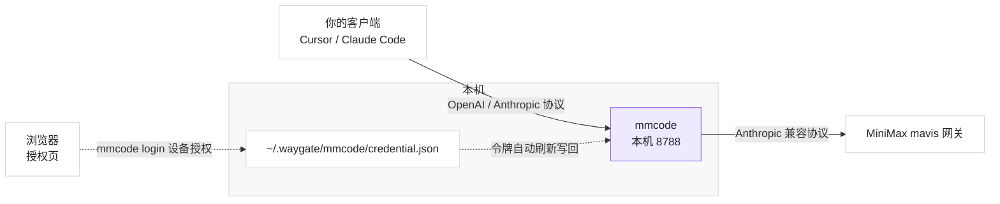

# waygate-mmcode

<div align="center">

**途关 · MiniMax Code 反代**

把 MiniMax Code 客户端的订阅，变成你自己的本地 API

[](https://www.npmjs.com/package/waygate-mmcode)


[快速开始](#快速开始) · [凭证互斥](#凭证互斥必读) · [客户端配置](#客户端怎么填) · [工作原理](#工作原理) · [常见问题](#常见问题) · [相关项目](#相关项目)

</div>

---

> [!CAUTION]
> **凭证互斥（必读）**：MiniMax 的 refresh token 是**一次性**的，且**同一账号同时只有一个有效会话**。
> 本工具与官方客户端（桌面端**或**官方 `mcode` CLI）登录**同一个账号**会**互相踢下线**。
>
> **解决**：给本工具配一个**专用账号**（与日常使用的账号分开注册一个即可）。
> 跑 `mmcode login`（浏览器授权）→ 此后**永远不在那个账号上登录任何官方客户端**。

**用官方 OAuth 设备授权登录，在本机起一个 Anthropic / OpenAI 兼容的聊天端点** ——
Cursor、Claude Code、Cherry Studio、任何能改 base_url 的工具，都能直接用你的订阅额度。

- **零配置接入** —— 一条命令起服务，打印出「代理地址 + 密钥 + 模型 ID」
- **浏览器授权登录** —— `mmcode login` 打印一个链接，点开授权即可；**不需要装桌面客户端**，
  服务器上也能自助登录（这正是它相比「读本机登录态」方案的用处）
- **两个协议都认** —— `POST /v1/chat/completions`（OpenAI）与 `POST /v1/messages`（Anthropic）
- **只在本机转** —— 写 `~/.waygate/`、本机转发；不向任何第三方上传数据

## 快速开始

```bash
# 全局安装
npm i -g waygate-mmcode

# 登录：打印授权链接（浏览器打开、用你的 MiniMax 账号完成授权）
mmcode login

# 启动
mmcode
```

`mmcode login` 会**原地等你 2 分钟** —— 你在浏览器点完授权，终端**自动继续**，无需再来一次。
若超过 2 分钟，它会提示你用 `mmcode login-poll` 续跑（设备码 5 分钟内有效）：

```
请用浏览器打开下面的链接完成授权（用你的 MiniMax 账号）：

  https://account.minimax.cn/oauth-authorize?user_code=Z2MD-MW5P

  短码：Z2MD-MW5P（链接已含，直接打开即可）

授权完成后本终端会**自动继续**（最多等 120 秒）。

✓ 登录成功 → ~/.waygate/mmcode/credential.json
```

```
途关 · MiniMax Code 反代 v0.3.4

凭证    ✓ access 有效约 187 分钟（账号 01a0d156…）
上游    https://agent.minimax.cn  (Anthropic 兼容)
代理    http://127.0.0.1:8788/v1   （OpenAI 系客户端：Cursor / Cherry Studio / OpenAI SDK）
        http://127.0.0.1:8788      （Anthropic 系客户端：Claude Code，它自己会补 /v1）
密钥    sk-mmcode-1a2b3c4d5e6f7a8b9c0d1e2f3a4b5c6d

模型 ID（填进你的客户端）：
  MiniMax-M3
  MiniMax-M3.1-Flash-Preview
  MiniMax-M2.7
  MiniMax-M2.7-highspeed

把上面的「代理地址 + 密钥」填进 Cursor / Claude Code / Cherry Studio 等客户端即可。
按 Ctrl+C 停止。
```


**要求**：Node.js ≥ 20；**不需要**装 MiniMax Code 桌面客户端（登录走浏览器授权）。

## 凭证互斥（必读）

MiniMax 的会话机制决定了**同一个账号同时只有一个有效会话**。这意味着：

| 你做的事 | 后果 |
| --- | --- |
| 本工具在跑 → 你登录官方客户端 / `mcode` CLI（同一账号） | **本工具失效**，需重跑 `mmcode login` |
| 官方客户端在用 → 你启动本工具（同一账号） | 官方客户端被踢下线 |

**正确姿势**：注册一个专用账号，**只用它跑 `mmcode login`**（在浏览器里授权），
此后**永远不在那个账号上登录任何官方客户端**。日常账号照常用客户端，两边互不干扰。

> ⚠️ **走设备授权并不会解除互斥**。它改变的是「在哪台机器上登录」（服务器也能自助授权），
> 不是「能有几个会话」。同一个账号只要在别处登过一次，本工具手里的 refresh token 立刻作废。

## 命令

```bash
mmcode               # 启动反代（同 mmcode serve），打印模型 ID 与代理地址
mmcode models        # 只列出模型 ID（不起服务）
mmcode doctor        # 自检：端口 / 凭证 / 令牌刷新 / 上游连通
mmcode login         # 登录（浏览器授权一次；等 2 分钟无授权则改用 login-poll）
mmcode login-poll    # 完成登录：浏览器授权后取票（`login` 等待超时也用它）
mmcode checkin       # 每日签到领积分（用本工具令牌代签，无需开客户端）
mmcode credits       # 查积分账本（剩余 / 已消耗 / 累计，精确到 0.01）
```

**签到与积分**（MiniMax Code 专属）：

```bash
$ mmcode checkin
✓ 签到成功 +400 积分（连续第 4 天）

$ mmcode credits
MiniMax Code 积分账本

剩余    4188.65
已消耗  6611.35
累计发放 10800
最近到期 2026-10-14

批次明细（17 笔）：
  +400  剩 400  用 0  到期 2026-11-12
  +800  剩 188.65  用 611.35  到期 2026-11-05
  …（还有 7 笔）

注：上游不回报单次请求消耗，以上为账户级批次累计（精确到 0.01）。
```

> **为什么能代签**：签到接口用的就是本工具已在维护的 access token。所以你**不需要为了签到去登录客户端**
> ——（登录客户端反而会踢掉本工具）。加 `--json` 可得到机器可读输出，便于脚本/定时任务。

| 参数 | 说明 |
| --- | --- |
| `--port <n>` | 监听端口（默认 8788） |
| `--host <addr>` | 监听地址（默认 `127.0.0.1`） |
| `--key <sk-…>` | 指定入站密钥（默认自动生成并缓存） |
| `--json` | 机器可读输出 |
| `--verbose` | 打印每个请求的路由日志 |

## 客户端怎么填

**Cursor / Cherry Studio / OpenAI SDK**

- Base URL：`http://127.0.0.1:8788/v1`
- API Key：启动时打印的 `sk-mmcode-…`
- 模型：模型 ID（如 `MiniMax-M3`）

**Claude Code**

```bash
ANTHROPIC_BASE_URL=http://127.0.0.1:8788
ANTHROPIC_API_KEY=sk-mmcode-…
```

暴露的端点：`POST /v1/chat/completions` · `POST /v1/messages` · `GET /v1/models` · `GET /healthz`

支持流式（SSE）与非流式（`stream: false` 时自动聚合为单个 JSON）两种响应模式。

## 工作原理



- **凭证**：走 MiniMax **官方 OAuth 2.0 设备授权**（RFC 8628 + PKCE S256，端点 `account.minimax.cn/oauth2/device/code`）。
  `mmcode login` 打印授权链接，你在浏览器完成授权后取票，写到 `~/.waygate/mmcode/credential.json`（0600）。
  **不读本机客户端文件、不解密任何东西**；参数与官方 `mcode` CLI 同一个 OAuth client（`mcode-public`）。
- **令牌生命周期**：access token（`mmoat_`）寿命短（约 1–4 小时），到期前 2 分钟自动刷新；refresh token（`mmort_`）刷新后会被上游**轮换**，本工具自动写回本地。
- **模型清单**：上游**没有**清单端点（实测 `/models` 恒 503）—— 用内置清单（4 个模型），这是「目录 = 接口」原则的唯一例外。

> [!NOTE]
> **单次请求的积分消耗上游不回报** —— MiniMax 的聊天响应只有 token 数，没有单次费用字段。
> 积分余额以[官方客户端](https://www.minimax.io)的账本页为准（精确到 0.01）。

## 常见问题

**要装 MiniMax Code 客户端吗？** **不要。** 登录走浏览器授权（`mmcode login`），任何能开浏览器的机器都行 —— 服务器上也能自助登录。

**令牌被顶掉了怎么办？** 有人用同一账号登录了官方客户端或 `mcode` CLI —— 本工具被踢。跑一次 `mmcode login` 重新授权即可（确保此后没人再登那个账号）。

**会不会把我的令牌上传？** 不会。全程只在本机读写：浏览器授权 → 写 `~/.waygate/` → 本机转发。代码开源可查。

**端口被占用？** `mmcode --port 9790`，或 `mmcode doctor` 看是哪一项没过。

**支持 macOS / Linux 吗？** 是。凭证是明文 JSON，无平台专有加密。

## 免责声明

仅供**个人学习与研究**使用，请遵守 MiniMax 的服务条款。上游接口随时可能变更，届时本工具可能失效（`mmcode doctor` 是排查入口）。作者不对使用后果负责。

## 相关项目

- **[waygate-qoder](https://github.com/zhanghaojie513/waygate-qoder)** —— 同款工具，对应 Qoder CN（`npm i -g waygate-qoder`）
- **[waygate-workbuddy](https://github.com/zhanghaojie513/waygate-workbuddy)** —— 同款工具，对应 WorkBuddy（`npm i -g waygate-workbuddy`）
- **[waygate-core](https://github.com/zhanghaojie513/waygate-core)** —— 三个工具共用的骨架（`npm i waygate-core`）
- **[waygate-open](https://github.com/zhanghaojie513/waygate-open)** —— 同一作者的完整多提供商反代（含控制台、用量统计）

## License

MIT
